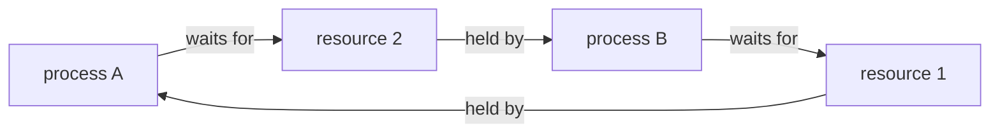
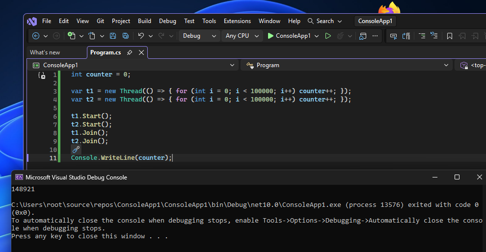
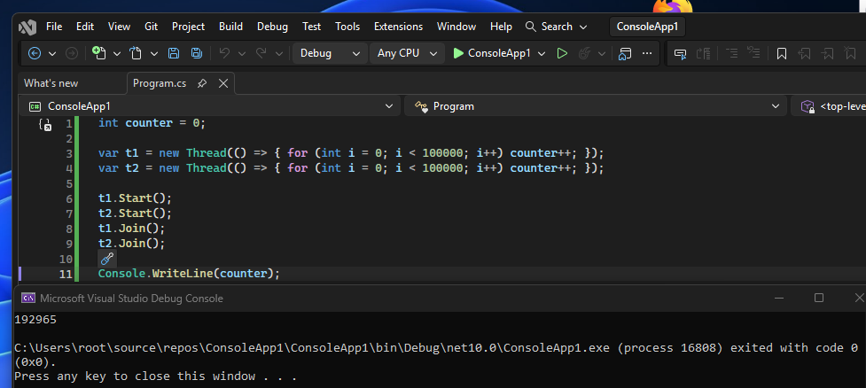
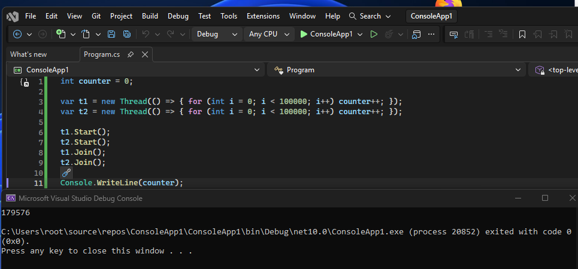
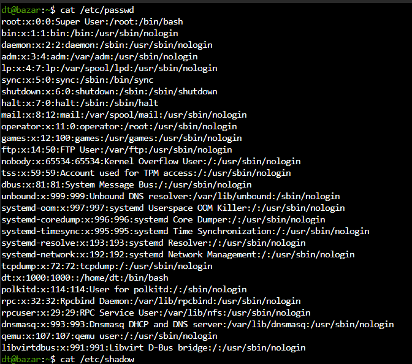
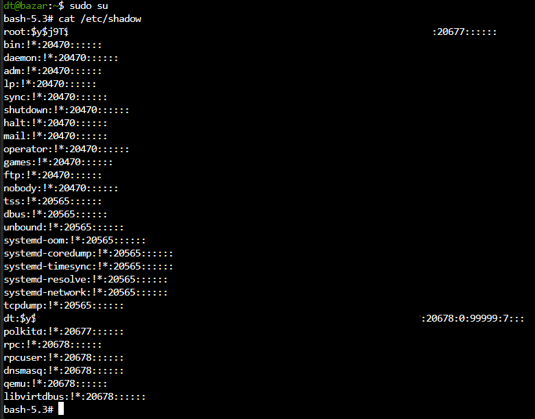

# autorization vs authentication
autorization is the right to perform a given operation something like rwx 

authentication is when you're using credentials 

# loopback / 127.0.0.1
127.0.0.1 - loopback address, `localhost` is the hostname that leads to it (in IPv6 to `::1`)
the whole 127.0.0.0/8 block from 127.0.0.0 to 127.255.255.255 is reserved for loopback
every address in this block (e.g. 127.0.0.2) behaves the same way meaning traffic never leaves the machine, but they are separate addresses, not identical to 'localhost'
example: 127.0.0.2:8080 can be a different service than localhost:8080, because localhost leads to 127.0.0.1

on Linux and Windows the whole 127.0.0.0/8 block works out of the box
on macOS only 127.0.0.1 is configured by default, so e.g. 127.0.0.2 requires adding an alias manually:
  - add: `sudo ifconfig lo0 alias 127.0.0.2 up`
  - remove: `sudo ifconfig lo0 -alias 127.0.0.2`
  - the alias disappears after a system restart

# encryption 
symetric - the same key is used in and out example: WPA2 AES

asymetric - a pair of keys, public encrypts data and private decrypts it example: RSA

# encryption vs hashing 
encryption is reversible example: AES

hashing is one-way example: MD5 (broken) and SHA-256 (good example if you want to check integrity with downloaded system ISO and most secure way is to check GPG signature if it's possible)

# deadlock 
two or more processes wait for resource held by each other 

important point here is: Coffman conditions

# race condition
two or more processes (or threads) use the same resource at the same time and the result depends on the order of their actions 

code: [rc-example.cs](rc-example.cs)

# HTTP response status codes

reference: [MDN - HTTP response status codes](https://developer.mozilla.org/en-US/docs/Web/HTTP/Reference/Status)

# /etc/passwd and /etc/shadow

user accounts in Linux are stored in two files

/etc/passwd - username, password placeholder (x), user ID (UID), primary group (GID), comment, home directory, shell

/etc/shadow - username, password (as a hash), date of last password change

passwd is readable by everyone, shadow only by root, so the password hashes are not exposed

examples from my system:

# TCP vs UDP

TCP - connection-oriented, reliable
- starts with the three-way handshake: SYN -> SYN-ACK -> ACK
- waits for confirmation (ACK) of the data and sends it again if it is lost
- keeps the right order of data
- slower, because of the extra work

UDP - connectionless, not reliable
- no handshake, it just sends the data and does not check if it arrived
- no confirmation, no resending, order is not guaranteed
- faster and lighter

# SQL injection

user input is treated as part of the SQL query instead of plain text

example: login form with input `' OR '1'='1`

vulnerable code (the input is glued into the query):

`SELECT * FROM users WHERE name = '` + input + `'`

how to prevent it: use parameterized queries (prepared statements), the input is always treated as data, never as code

also: validate input, give the database account only the rights it needs (least privilege)

## blind SQL injection

the application does not show the result of the query directly, the attacker learns from its behavior

- boolean-based: the page is different for true and false
- time-based: the response is delayed (e.g. `SLEEP(5)`)

## SQL words to know

- `SELECT` - gets data from a table
- `UNION` - joins the results of two queries (same number of columns needed)
- `LIMIT` - limits the number of returned records

## other injection types

the same idea: user input is run as code by some interpreter

- CSS injection - attacker adds own CSS to the page (can change how it looks or leak data)
- NoSQL injection - input changes the query in a NoSQL database (e.g. MongoDB)
- LDAP injection - input changes an LDAP query (directory services, e.g. logins)
- command injection - input is run as an operating system command (e.g. `; ls`)
- server-side template injection (SSTI) - input is run inside the server's template engine, can lead to code execution on the server

