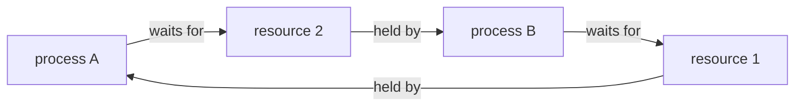

# autorization vs authentication
autorization is the right to perform a given operation something like rwx 

authentication is when you're using credentials 

# loopback / 127.0.0.1 - material to CCST 100-150 Networking 
127.0.0.1 - loopback address, `localhost` is the hostname that leads to it (in IPv6 to `::1`)
the whole 127.0.0.0/8 block from 127.0.0.0 to 127.255.255.255 is reserved for loopback
every address in this block (e.g. 127.0.0.2) behaves the same way meaning traffic never leaves the machine, but they are separate addresses, not identical to 'localhost'
example: 127.0.0.2:8080 can be a different service than localhost:8080, because localhost leads to 127.0.0.1

on Linux and Windows the whole 127.0.0.0/8 block works out of the box
on macOS only 127.0.0.1 is configured by default, so e.g. 127.0.0.2 requires adding an alias manually:
  - add: `sudo ifconfig lo0 alias 127.0.0.2 up`
  - remove: `sudo ifconfig lo0 -alias 127.0.0.2`
  - the alias disappears after a system restart

# encryption 
symetric - the same key is used in and out example: WPA2 AES

asymetric - a pair of keys, public encrypts data and private decrypts it example: RSA

# encryption vs hashing 
encryption is reversible example: AES

hashing is one-way example: MD5 (broken) and SHA-256 (good example if you want to check integrity with downloaded system ISO and most secure way is to check GPG signature if it's possible)

# deadlock 
two or more processes wait for resource held by each other 

